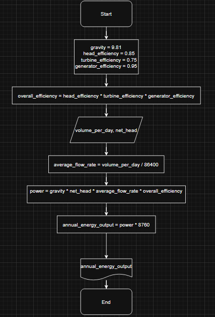
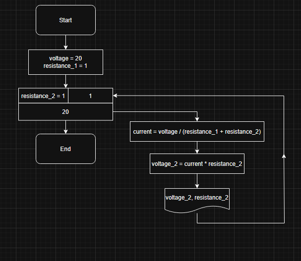
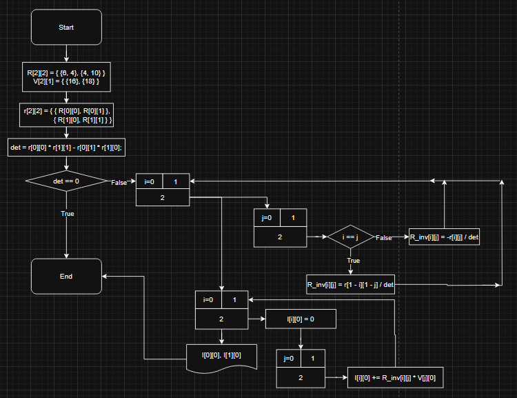

# ELM2080 C Programming Assignments

Solutions to the three take-home assignments of ELM2080 Introduction to C Programming and Engineering Applications
at Yildiz Technical University (YTU), spring 2025. Each assignment is a small engineering calculation written in plain C
and came with a flowchart. Some folders hold more than one version because I also wrote alternative solutions while
helping classmates check their work.

## Repository structure

```
hw1-hydro-energy/
  hydro_energy.c                 submitted solution, corrected (see Notes)
  hydro_energy_annual_volume.c   same result from a yearly volume, computed in joules
  hydro_energy_validated.c       rejects non-numeric or non-positive input
hw2-voltage-divider/
  voltage_divider.c              submitted solution, with the required heading added
hw3-mesh-current/
  mesh_current_loops.c           submitted solution, inverse and product in loops with a singular matrix check
  mesh_current.c                 inverse written out element by element
  mesh_current_adjugate.c        R matrix built from R1, R2, R3 and inverted with the adjugate
docs/images/                     flowcharts as submitted
```

## Assignments

### 1. Hydroelectric plant energy

A dam collects water that falls to a plant with head, turbine and generator efficiencies of 85 %, 75 % and 95 %.
The program reads the daily water volume (m³/day) and the head (m) and prints the annual energy output.

```
E = ρ · g · H · V_year · η_head · η_turbine · η_generator
```

With the values from the assignment (750 · 10⁶ m³ per year, which is 2054794.52 m³/day, and a head of 600 m − 200 m = 400 m):

```
$ ./hydro_energy
Enter the water volume per day (m^3/day): 2054794.5205
Enter the net head (m): 400
The annual energy output is: 495098437.49 kWh
```



### 2. Voltage across R2

A 20 V source drives R1 = 1 Ω in series with R2. The program steps R2 from 1 Ω to 20 Ω in a loop and prints the voltage across R2
with two decimals. It takes no input.

```
$ ./voltage_divider
Voltage across R2
R2 =  1 ohm: 10.00 V
R2 =  2 ohm: 13.33 V
...
R2 = 20 ohm: 19.05 V
```



### 3. Mesh currents with matrices

A two-mesh circuit with R1 = 2 Ω, R2 = 6 Ω, R3 = 4 Ω (shared) and sources of 16 V and 18 V. The mesh equations are written as
V = R · I and solved as I = R⁻¹ · V, as required by the assignment.

```
R = | 6   4 |    V = | 16 |
    | 4  10 |        | 18 |
```

```
$ ./mesh_current_loops
Current matrix (2x1):
I_A = 2.00 A
I_B = 1.00 A
```



## Building

Any C99 compiler works. With gcc and make

```
make          # builds every program into bin/
make clean
```

or a single file

```
gcc -std=c99 -Wall hw2-voltage-divider/voltage_divider.c -o voltage_divider
```

The assignments were originally written in Dev-C++ on Windows and have also been compiled with gcc on Linux.

## Notes

- The submitted hydro program left out the water density and printed Wh labelled as kWh. The two mistakes cancelled
  each other, so the number was right for the wrong reason. The code here uses ρ = 1000 kg/m³ and converts explicitly,
  while the flowchart still shows the formula as it was submitted.
- The voltage divider assignment asked for a heading line before the results. The submitted version did not print it,
  and the version here does.
- The flowcharts are kept as they were submitted.
